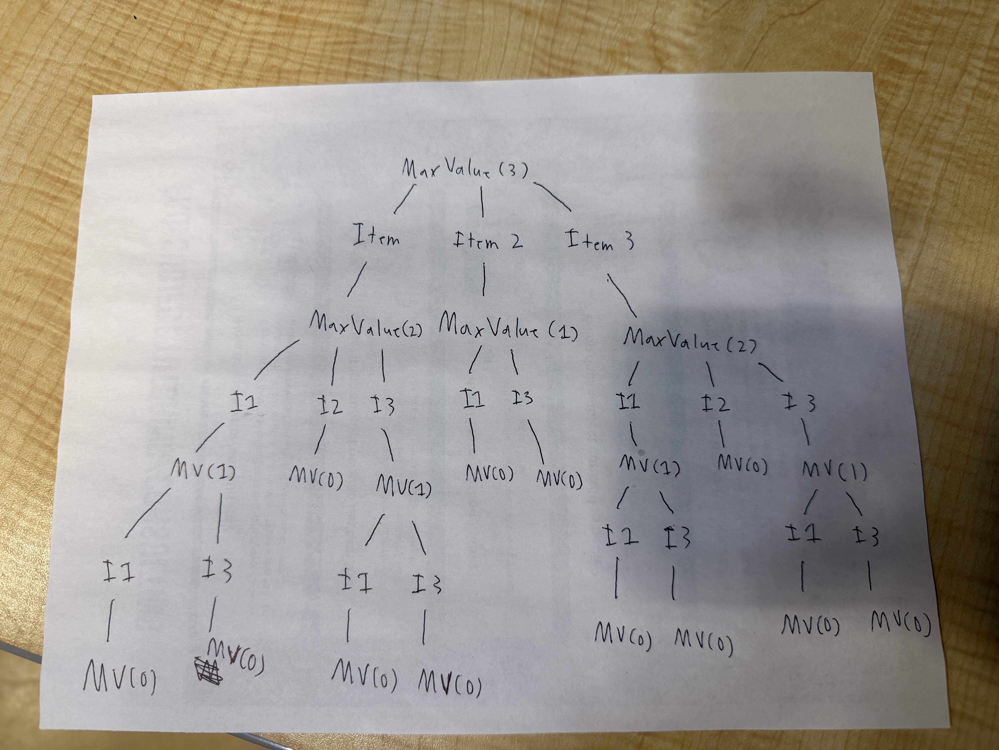

# Lab 07: The Integer-Valued Knapsack Problem

**Name:** Samuel Roque

I have attached a screen shot of when I completed this assignment and drew out the answer for part 3 as proof I had this assignment done but I have mistakenly did my work in the template repo for this lab. After realizing my mistake, I copied my answer into my own fork and pushed my answers again.

## Introduction

In this lab, you will explore different variations of the Knapsack problem and design a dynamic programming solution for one of them. You may work in small groups or individually, but everyone should write up their own answers to the questions below.

Suppose we're going hiking. We have items $1, \ldots, n$ that we could pack in multiples with corresponding values $v_1, \ldots, v_n$ and weights $w_1, \ldots, w_n$. For example, we might have a water bottle (weight 1, value 2) and a sandwich (weight 2, value 5). Consider the following three problem variations:

1. Maximize value subject to capacity $W$, where you can pack at most one of each item.
2. Maximize value subject to capacity $W$, where you can pack a positive integer value of each item.
3. Minimize weight subject to minimum value $V$, where you can pack a positive integer value of each item.

---

## Part 1: Dynamic Programming Fundamentals

**Question:** Which of the three problem variations can be solved using the dynamic programming approaches we've studied in lecture? Explain your reasoning.

*Your Answer:* All three variations can be solved using dynamic programming. Each problem can be broken down into smaller versions of the same problem, and the solutions to those smaller problems can be stored and reused. For variation 1, we would also need to keep track of which items have already been used because each item can only be chosen once. Variations 2 and 3 allow items to be used multiple times, so their subproblems can be based mainly on the remaining capacity or remaining value.

## Part 2: The Naive Recursive Algorithm

Below is a naive recursive algorithm intended to solve one of the variations listed above.

```text
Function MaxValue(W):
    if W == 0:
        return 0
        
    max_val = 0
    for i from 1 to n:
        if w_i <= W:
            current_val = v_i + MaxValue(W - w_i)
            if current_val > max_val:
                max_val = current_val
                
    return max_val
```

**Question:** Which of the three problem variations (1, 2, or 3) does this algorithm solve? How do you know? Explain your reasoning.

*Your Answer:* This algorithm solves variation 2, where the goal is to maximize the value without going over capacity WWW, and each item can be used multiple times. I know this because every recursive call only reduces the remaining capacity by the weight of the chosen item. The algorithm does not remove an item after choosing it, so the same item can be selected again in later recursive calls. It also keeps track of the maximum value, which matches the goal of variation 2.

## Part 3: Recursion Tree

Consider the following simple example:

* **Knapsack Capacity:** $W = 3$

* **Item 1:** Weight $w_1 = 1$, Value $v_1 = 2$
* **Item 2:** Weight $w_2 = 2$, Value $v_2 = 5$
* **Item 3:** Weight $w_3 = 1$, Value $v_3 = 3$

**Question:** Draw the full recursion tree for `MaxValue(3)` using the example above. Label the remaining capacity at each node and indicate which item is chosen along each branch.

*Your Answer (take a picture and upload it):*


## Part 4: Recurrence Relation

**Question:** Derive a mathematical recurrence relation for $OPT(W)$, the maximum value you can pack into a knapsack of capacity $W$, based on the naive recursive algorithm. Be sure to state your base case(s) and explain how you arrived at your formula.

*Your Answer:*
The base case is:

$$
OPT(0) = 0
$$

because a knapsack with no remaining capacity cannot have any additional value.

For $W > 0$, the recurrence is:

$$
OPT(W) = \max_{i:w_i \leq W} \{v_i + OPT(W-w_i)\}
$$

This works because for every item that fits in the remaining capacity, I can choose that item, add its value, and then solve the smaller problem with capacity $W-w_i$. I compare all of those choices and keep the one that gives the maximum total value. Since items can be chosen multiple times, the same item is still available in the smaller problem.

## Part 5: Bottom-Up Dynamic Programming

Instead of using the slow recursive approach, we can build a table bottom-up.

**Question:** Use your recurrence relation from Part 4 to fill in the following table for the example provided in Part 3 ($w_1=1, v_1=2$ and $w_2=2, v_2=5$). At each step, record the optimal value and the specific item chosen to achieve that value.

| Capacity ($W$) | Optimal Value ($OPT$) | Item Chosen |
| :---: | :--- | :--- |
| **0** | 0 | None |
| **1** | 2 | Item 1 |
| **2** | 5 | Item 2 |
| **3** | 7 | Item 1 or Item 2 |
| **4** | 10 | Item 2 |
| **5** | 12 | Item 1 or Item 2 |
| **6** | 15 | Item 2 |

*Explain how you calculated the row for $W=6$*

For $W=6$, I checked both items using the values that were already calculated in the table. If I choose Item 1, I get:

2 + OPT(5) = 2 + 12 = 14

If I choose Item 2, I get:

5 + OPT(4) = 5 + 10 = 15

Since 15 is larger than 14, I choose Item 2. Therefore:

OPT(6) = 15

## Part 6: Traceback

**Question:** Using the "Item Chosen" column from the table you completed in Part 5, trace back to find the exact quantities of each item to pack that maximize the value. What is the final optimal packing configuration for $W=6$ and the maximum value?

*Your Answer:*
Starting at $W=6$, the table tells me to choose Item 2, which has a weight of 2 and a value of 5. This leaves a capacity of $6-2=4$. At $W=4$, I choose Item 2 again, which leaves a capacity of $4-2=2$. At $W=2$, I choose Item 2 one more time and reach a remaining capacity of 0.

Therefore, the optimal packing configuration is:

* **Item 1:** 0
* **Item 2:** 3
* **Total Weight:** $3(2)=6$
* **Maximum Value:** $3(5)=15$

So for $W=6$, I should pack three copies of Item 2 for a maximum value of **15**.
